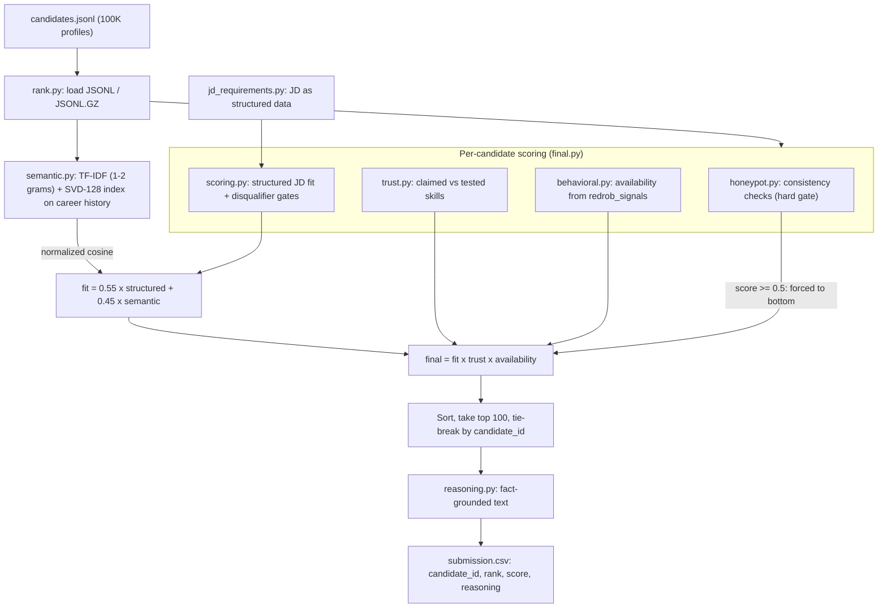

# Redrob Ranker

A deterministic, CPU-only pipeline that ranks the top 100 candidates out of a 100,000-profile pool for a Senior AI Engineer role. It is built to resist keyword stuffing and fabricated profiles.


**Live demo:** [Hugging Face Space](https://huggingface.co/spaces/Suriya-25/redrob-ranker) · **Methodology deck:** [`HackerX_Methodology.pdf`](HackerX_Methodology.pdf)

## Overview

This is team **HackerX**'s solo submission to the Redrob **"Intelligent Candidate Discovery & Ranking Challenge"** hackathon. The task: given `candidates.jsonl` (100,000 synthetic candidate profiles) and a [job description](hackathon_bundle_docs/job_description.md) for a *Senior AI Engineer, Founding Team*, produce a CSV of the 100 best-fit candidates, each with a score and a short written justification.

The challenge is built around traps:

- The JD states that the right answer is *not* "find candidates whose skills section contains the most AI keywords". The dataset contains thousands of keyword stuffers, such as HR Managers or Accountants listing RAG and fine-tuning.
- About 80 **honeypot** profiles are internally inconsistent (fabricated). More than 10% honeypots in the top 100 disqualifies a submission.
- Some genuinely ideal candidates describe their skills in plain, paraphrased language ("Vector Representations" instead of "embeddings"), so they slip past exact keyword matching.
- The run must finish within **5 minutes on CPU, with 16 GB RAM and no network** ([`submission_spec.md`](hackathon_bundle_docs/submission_spec.md)).

The pipeline combines structured JD rules, semantic similarity on career-history prose, a check of claimed versus tested skills, availability signals and a honeypot hard gate. It then writes fact-grounded reasoning for each of the top 100. No LLM or network call is made during ranking.

## Key features

- **Honeypot hard gate** ([`src/honeypot.py`](src/honeypot.py)). It checks years of experience against career history, single-role duration sanity, date arithmetic, "expert" skills with zero duration, and education-year sanity. A flagged profile is forced to the bottom; the score is not just blended down.
- **Structured JD-fit scoring** ([`src/scoring.py`](src/scoring.py)). A weighted score of title (0.32), must-have skill-family coverage (0.30), experience band (0.18), location (0.12) and notice period (0.08). On top of that come multiplicative disqualifier gates (off-target title, pure consulting career, title-chasing, research-only background, recent LangChain-only experience, CV/speech/robotics focus) and a nice-to-have bonus.
- **JD encoded as data** ([`src/jd_requirements.py`](src/jd_requirements.py)). Titles, skill-family vocabularies, off-target titles and preferred locations are auditable constants rather than logic buried in code.
- **Semantic similarity** ([`src/semantic.py`](src/semantic.py)). TF-IDF over unigrams and bigrams (20k features), reduced with TruncatedSVD to 128 components. It compares each candidate's career-history prose with a profile text derived from the JD, which recovers candidates who paraphrase instead of using exact keywords.
- **Trust modifier** ([`src/trust.py`](src/trust.py)). It penalizes gaps between self-reported proficiency and the platform's tested `skill_assessment_scores`, and buzzword lists that the career history does not support. It also considers GitHub signal.
- **Behavioral availability modifier** ([`src/behavioral.py`](src/behavioral.py)). It uses `redrob_signals`: recency of activity, recruiter response rate, open-to-work status, interview reliability, offer acceptance and verification.
- **Deterministic reasoning** ([`src/reasoning.py`](src/reasoning.py)). One to two sentences built only from extracted facts (title, company, years of experience, skills, notice period, last activity), with rotated phrasing to avoid repetition.
- **Submission validator** ([`validate_submission.py`](validate_submission.py)). It checks the header, exactly 100 rows, the `CAND_XXXXXXX` ID format, unique ranks 1 to 100 and a non-increasing score.

## Architecture



| Component | Role |
|---|---|
| [`rank.py`](rank.py) | Single-command entry point. Loads candidates, builds or loads the semantic index, scores everyone, writes the top 100 and warns if the honeypot rate exceeds 10%. |
| [`precompute_index.py`](precompute_index.py) | Optional. Builds and pickles the semantic index ahead of time, so the timed run only does scoring. |
| [`src/final.py`](src/final.py) | Combines the four lenses: an additive blend for fit, multiplicative trust and availability, and the honeypot gate. |
| [`hf_space/`](hf_space/) | Gradio demo that runs the same `src/` modules on a 50-candidate sample. |
| [`data/gold_candidates.json`](data/gold_candidates.json) | Eight hand-identified "gold" candidates used as the validation set throughout development. |

### Why this design

- **Keyword matching alone reproduces the failure mode the JD criticizes.** An off-target title is a multiplicative gate rather than one weighted input, so a long skill list cannot compensate for it.
- **Structured scoring alone misses paraphrasers.** Before the semantic layer and the vocabulary fixes, one gold candidate ranked #4,151. The semantic layer works on career-history prose, not the skills list.
- **Verified versus claimed matters.** Analysis of the real dataset during development found that 34.3% of self-reported proficiency claims differ from tested assessment scores by more than 30 points.
- **Honeypots are a gate, not a blend.** This mirrors the ground truth's "forced to relevance tier 0" and the 10% disqualification rule.
- **No per-candidate LLM calls.** At 100 ms to 2 s per call, 100K candidates would take 2.8 to 55 hours against a 300-second budget. Local LLM re-ranking with Ollama was evaluated and deliberately left out.

## How it works

1. **Load.** `rank.py` reads `candidates.jsonl` (gzip is also supported).
2. **Index.** `build_semantic_index` turns each candidate's career-history descriptions into TF-IDF vectors, reduces them with SVD, and computes the cosine similarity with the JD profile text. Raw cosines, which cluster in roughly 0.3 to 0.95, are rescaled to the range 0 to 1.
3. **Score each candidate.** `combine_scores` runs the honeypot checks, structured scoring, trust and behavioral modifiers, then computes:

   ```text
   fit   = 0.55 * structured + 0.45 * semantic
   final = fit * trust_multiplier * availability_multiplier
   ```

   A candidate with `honeypot_score >= 0.5` gets a negative sentinel score and drops to the bottom.
4. **Rank.** Candidates are sorted by `final_score`. The top 100 are then re-sorted with the spec's tie-break (equal score: `candidate_id` ascending).
5. **Explain.** `generate_reasoning` writes one to two sentences per candidate from the facts in the profile and the notes produced by each scoring module.
6. **Write and validate.** The CSV columns are `candidate_id, rank, score, reasoning`, with scores clipped to a small positive floor for display. `validate_submission.py` checks the file against the spec.

## Tech stack

| Layer | Technologies |
|---|---|
| Language | Python 3.11 |
| Ranking pipeline | NumPy, scikit-learn (`TfidfVectorizer`, `TruncatedSVD`); everything else is the standard library |
| Demo | Gradio on Hugging Face Spaces |
| Constraints met | CPU only, no GPU, no network, no hosted LLM calls during ranking |

## Project structure

```text
redrob-ranker/
├── rank.py                    # Entry point: candidates.jsonl -> submission.csv
├── precompute_index.py        # Optional offline semantic-index build
├── validate_submission.py     # Checks the CSV against the submission spec
├── requirements.txt           # numpy, scikit-learn
├── src/
│   ├── honeypot.py            # Fabricated-profile detection (hard gate)
│   ├── jd_requirements.py     # JD encoded as structured data
│   ├── scoring.py             # Structured JD-fit scoring + disqualifiers
│   ├── semantic.py            # TF-IDF + SVD similarity
│   ├── trust.py               # Claimed-vs-tested skill trust modifier
│   ├── behavioral.py          # Availability modifier from redrob_signals
│   ├── final.py               # Score combination
│   └── reasoning.py           # Deterministic reasoning text
├── hf_space/                  # Gradio demo (same src/ modules + 50-candidate sample)
├── data/gold_candidates.json  # 8-candidate validation set
├── hackathon_bundle_docs/     # JD, submission spec, signals reference, schema
├── VALIDATION_LOG.md          # Bugs found and fixed against the real dataset
├── FINAL_VALIDATION_REPORT.md # Final metrics
├── HackerX_Methodology.pdf / .pptx
├── submission.xlsx            # Spreadsheet copy of the final ranking
└── submission_metadata.yaml   # Hackathon submission metadata
```

## Getting started

### Prerequisites

- Python 3.11
- The hackathon's `candidates.jsonl`. It is distributed with the challenge bundle and is not included in this repository (it is git-ignored).

### Install and run

```bash
pip install -r requirements.txt
python rank.py --candidates candidates.jsonl --out submission.csv
python validate_submission.py submission.csv
```

Optional precompute split:

```bash
python precompute_index.py --candidates candidates.jsonl --out artifacts/semantic_index.pkl
python rank.py --candidates candidates.jsonl --out submission.csv --precomputed-index artifacts/semantic_index.pkl
```

### Command-line options (`rank.py`)

| Flag | Required | Description |
|---|---|---|
| `--candidates` | yes | Path to `candidates.jsonl` or `.jsonl.gz` |
| `--out` | yes | Output CSV path |
| `--precomputed-index` | no | Pickled index from `precompute_index.py`; skips the index build |

No environment variables are used.

### Run the demo locally

The demo runs on the bundled 50-candidate sample, so the full dataset is not needed:

```bash
cd hf_space
pip install -r requirements.txt gradio
python app.py
```

### Sample output

```csv
candidate_id,rank,score,reasoning
CAND_0005538,3,0.9275,"<fact-grounded reasoning: title, company, years of experience, strengths and concerns>"
```

## Results

From [`FINAL_VALIDATION_REPORT.md`](FINAL_VALIDATION_REPORT.md) (full 100K-candidate run, 2026-06-29):

| Metric | Value |
|---|---|
| Gold candidates in the top 100 | 7 of 8 (best rank #3; the eighth is at #175 for documented reasons) |
| Keyword-stuffer traps identified | 3,029; max score 0.0279; 0 in the top 100 |
| Honeypots detected | 59; 0 in the top 100 |
| Reasoning contradictions | 0 of 100 |
| Hallucination spot-check | 0 issues in 15 sampled candidates |
| Most-repeated reasoning phrase | 17 of 100 strings |
| End-to-end runtime | 61.8 s cold start (budget 300 s) on an 8-core / 16 GB Windows laptop |

Timing breakdown: loading takes 4.3 s, building the semantic index 39 s, and scoring 100K candidates 17.5 s. The report also records one earlier run at 116.3 s on the same machine, before any fixes were applied.

[`VALIDATION_LOG.md`](VALIDATION_LOG.md) explains the bugs found against the real data and how they were fixed:

- a false-positive honeypot signal that fired on 7.5% of the pool
- missing skill-family synonyms
- an over-eager title-chaser rule
- a trust penalty that ignored sample size
- an off-target-title weighting that let traps reach 0.743

## Limitations

- **Tuned to one JD and one dataset.** The vocabularies, weights and normalization band were calibrated on this synthetic 100K pool and the Senior AI Engineer JD. Other roles need new `jd_requirements.py` data.
- **Small validation set.** Validation relies on 8 hand-identified gold candidates plus trap and honeypot counts. No official ground-truth labels are included.
- **Lexical semantics.** TF-IDF/SVD was chosen because the development environment could not download model weights. Sentence-transformer embeddings are the documented upgrade path in [`src/semantic.py`](src/semantic.py).
- **Honeypot recall.** 59 honeypots were detected against the spec's stated figure of about 80.

## Author

Built by [Suriyaprakash](https://github.com/suriyaprakash-25) (team HackerX, solo participant) for the Redrob hackathon.
